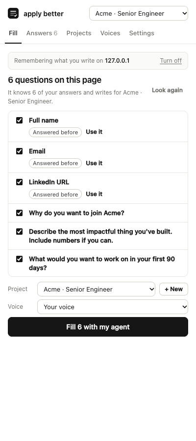
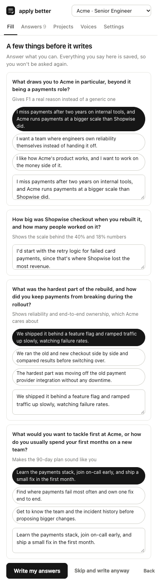
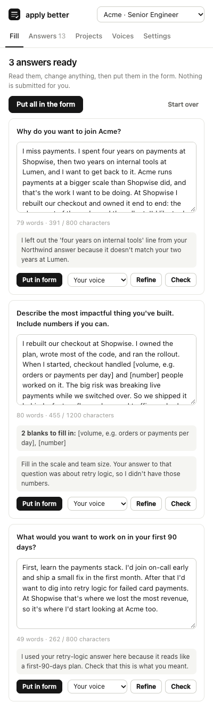

<p align="center"></p>

<h1 align="center">apply better</h1>

<p align="center"><b>Every application you write makes the next one faster.</b></p>

<p align="center">
A Chrome extension that remembers how you answer job, accelerator and grant applications, then fills the next form with you, in your own voice, using the Claude Code or Codex already on your computer.
</p>

<p align="center">
  
  
  
</p>

## What it does

- **Remembers what you write and pick.** Turn it on for a site and every answer you give in its forms is saved to your answer pool with the question it belongs to: typed answers, radio buttons, checkboxes and dropdowns (including the custom ones on Zoho, Google Forms and select2 forms). Passwords, codes and card numbers never are.
- **Answers you've given before are one click.** Name, links, "why this company", "your proudest result". If you've answered it, it's waiting for you.
- **Asks before it writes.** Press *Fill with my agent* and it reads your past answers, works out what it still doesn't know, and asks you a few short questions first, with suggested answers. What you tell it is saved, so you're never asked twice.
- **Writes like you.** Drafts match your sentence length, your words and your tone, learned from what you've written (and only from what *you* wrote, never from drafts it gave you). Missing facts become a visible `[blank]` instead of something made up.
- **Voices.** Have an answer come across with more *Ownership*, or make it *Crisp*, *Founder*, *Proof*, *Warm* or *Plain*, or describe your own. Check any answer against a voice and get a score and line-by-line fixes, or have it rewritten.
- **Projects.** One per application ("YC W27", "Stripe, product role"). The answers you write land in it, and its notes tell the agent what this application cares about.

You review everything. Drafts go into the form only when you press *Put in form*, and nothing is ever submitted for you.

## Your writing stays yours

- Everything is stored in your browser. Export or delete it any time from Settings.
- It writes with **your own** Claude Code or Codex, on your plan, on your machine. No apply-better server, no account, no API key.
- Your agent sees only what's relevant to the form in front of you: your notes, your closest past answers and a few samples of your writing.
- Form pages can contain anything, so the agent runs with **every tool turned off** (`claude --tools ""`, or Codex's read-only sandbox) in an empty scratch folder. It can only write text back.
- It only reads pages on sites you turn on, one site at a time. Chrome asks for that site and nothing else.

## Set it up

You need Chrome (or another Chromium browser), Node 20+, and [Claude Code](https://claude.com/claude-code) or [Codex](https://github.com/openai/codex) installed and signed in. macOS and Linux for now.

```sh
git clone https://github.com/tyhh00/apply-better.git
cd apply-better
npm install
npm run build      # builds the extension into dist/
npm run connect    # lets the extension reach Claude Code / Codex on this computer
```

Then in Chrome:

1. Open `chrome://extensions`, switch on **Developer mode**, press **Load unpacked** and pick the `dist` folder.
2. Pin **apply better** and click it to open the side panel.
3. Go to any application form and press **Turn on for this site**.

Write your answers as usual and they're remembered. On the next form, press **Fill with my agent**.

`npm run connect` writes a small launcher to `~/.apply-better/` and tells your browsers which extension may use it. Run it again if you move the folder or install a new agent. `npm run disconnect` removes it.

## How it works

```
 side panel ─┐                     ┌─ claude -p --safe-mode --tools "" --json-schema …
             ├─ background ─ native messaging ─ bridge ─┤
 the form ───┘   (your data)        (Chrome starts it)  └─ codex exec --sandbox read-only --output-schema …
```

- **The extension** (`src/`) finds each box on the page and the question it belongs to (labels, ARIA, or the block of text around it), saves what you type, and puts drafts back in a way React and other frameworks notice.
- **The bridge** (`bridge/`) is a tiny Node program with no dependencies that Chrome starts on demand through [native messaging](https://developer.chrome.com/docs/extensions/develop/concepts/native-messaging). Only this extension's ID may talk to it. It runs your agent non-interactively, in an empty temp folder, and hands back JSON.
- **Filling** is two calls: *plan* (what's missing? ask at most 6 questions) and *draft* (write every answer). Past answers are matched to the new questions with BM25 locally, so there's no embedding model and no extra service.

## Develop

```sh
npm run dev        # rebuilds dist/ on change; reload the extension in chrome://extensions
npm test           # unit tests: question detection, matching, the store, the bridge
npm run e2e        # a throwaway Chromium with the extension, the bridge and three test forms
E2E_AGENT=claude npm run e2e   # the same, with your real Claude Code
HEADED=1 npm run e2e           # watch it
```

The end-to-end run turns a site on, types answers (and checks the password isn't kept), picks a hidden Zoho-style radio, checkboxes, a select2-style dropdown and a Google-Forms-style radio, makes a project, reuses answers on a second form, has the agent ask and draft, puts the drafts in, checks the next application asks less, runs the voices, and turns the site off again. Screenshots land in `test/e2e/out/`.

## Not yet

- Windows (the bridge needs a registry entry there).
- File uploads, date pickers and dropdowns that load their options as you type.
- A form embedded from another site (e.g. a job board inside a company page) needs that site turned on too.
- The Chrome Web Store. For now you load it unpacked. If you publish your own build, pass its ID with `npm run connect -- --extension-id <id>`.

Pull requests welcome.

## License

[MIT](LICENSE)
